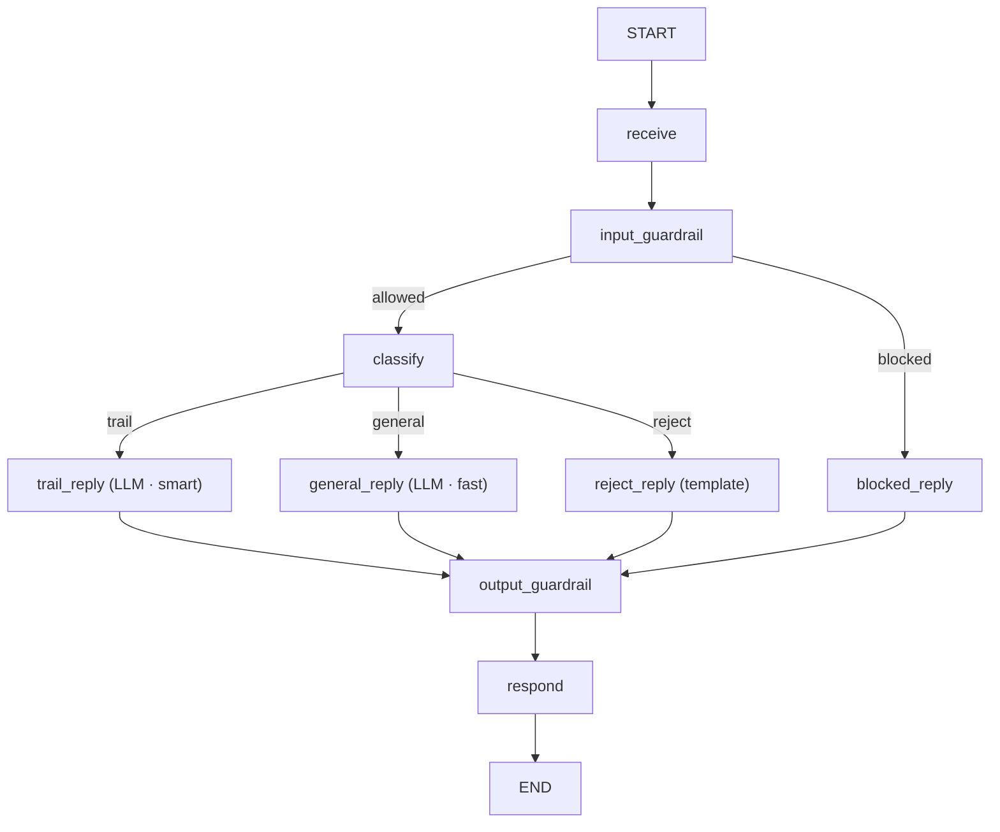

# Phase 1 design: trailmate-workflow (deterministic LangGraph workflow)

- **Date:** 2026-11-18
- **Source brief:** `../../../../Phase 1 - Workflow Orchestration with LangGraph.pdf` (IterForge training program, Phase 1 of 4)
- **Status:** approved by the trainee on 2026-11-18 (personal-data test data: option (a))
- **Revised 2026-11-19 (trainee):**
  - No git operations; this replaces 7.14.
  - A single step-by-step `docs/phase-1/BUILD-GUIDE.md` replaces the per-day notes in 7.13.
  - Per-day `.diff` files replace the day tags.

## 1. Intent and why

This is Phase 1 of a four-phase AI-engineering training program. The trainee wants three things:

- Build everything the phase requires, meeting its Definition of Done.
- Truly master the technologies involved.
- Give a live walkthrough at the end.

Phase 1 is about **deterministic orchestration**. Ordinary code makes every routing decision, and the graph's structure (not prompt engineering) is what makes the system predictable. A model is trusted only to generate text. Later phases hand more decisions to the model; the pieces built here are the ones that stay deterministic after that.

TrailMate is the running example for all four phases: a small chat assistant that helps someone find a hiking trail. There is no real trail data yet.

**How the trainee will learn from it (decided):**
- One service that grows day by day, exactly as the PDF lays out.
- One git commit and one tag per day, so `git diff phase1-day2 phase1-day3` shows exactly what Day 3 added.
- A notes file per day covering the concepts, the decisions and why, how to verify, and "try it yourself" changes.
- One curated `RESOURCES.md` covering each concept on its own.
- No separate standalone practice scripts. That was option (b), and it was declined.

## 2. Goals

These come from the PDF's Definition of Done, plus the trainee's learning goals.

1. `trailmate-workflow` runs locally with a real multi-node LangGraph graph.
2. Three deterministic paths (trail / general / reject), chosen by rule-based classification and never by a model. The DoD minimum is two.
3. Two paths call a real LLM through LiteLLM → Ollama, each on a different named tier: trail uses `smart`, general uses `fast`. The DoD minimum is one; two shows why tiers exist.
4. Responses stream back over SSE, including the template paths.
5. Input and output guardrail nodes are in the graph, tested against tables of messages that should be blocked or allowed.
6. A live walkthrough script shows one message moving through classification, routing, guardrails, and a streamed response.
7. Documentation that teaches:
   - per-day notes
   - a service README
   - a graph diagram
   - a description of the SSE event format
   - the curated resources file

## 3. Non-goals

- Real trail data, retrieval, or RAG. Those come in later phases.
- Any model-driven decision: no LLM classifier, no tool calling, no agents, no LLM-based guardrails such as Llama Guard. These are mentioned in the docs as later options.
- Conversation memory or persistence (checkpointers, threads). Each request is a single turn.
- Auth, rate limiting, deployment, Docker (Docker isn't installed), cloud models.
- A web UI. A terminal client plus `curl` is enough. A browser page is a "try it yourself" exercise.

## 4. Anti-goals (failures even if everything "works")

- A model influences control flow anywhere: routing, guardrail verdicts, or fallbacks.
- Guardrail logic lives outside the graph. FastAPI's request validation (empty body, wrong type) is the only exception.
- Template paths fake token-by-token "typing". They have no tokens, and pretending otherwise is dishonest.
- Code the trainee can't explain in the walkthrough. Prefer plain, explicit code over clever abstractions.
- Secrets in the repo, or user/model text in logs or traces.
- A default test suite that needs Ollama or LiteLLM running.
- Throwing away earlier days' work. Each day extends the same code.

## 5. Constraints

| Area | Constraint |
|---|---|
| Tools (fixed by the PDF) | uv, LangGraph + langchain-core, FastAPI + sse-starlette, Ollama, LiteLLM (proxy) |
| Machine | Apple M5, 16 GB RAM, macOS. Ollama 0.40.16 is installed and its server is running, with no models pulled. No Docker. uv 0.13.7, Python 3.14.8. |
| Versions verified today on Python 3.14 | langgraph 1.2.22, langchain-core 1.8.3, langchain-openai 1.8.2, openai 3.55.1, fastapi 0.164.0, starlette 1.10.0, sse-starlette 3.7.0, pydantic 2.14.3. `get_stream_writer` exists; stream modes are values/updates/checkpoints/tasks/debug/messages/custom. |
| Org policy | No hard-coded secrets: `${ENV_VAR}` placeholders, real values only in a gitignored `.env`. Work on a branch; never push to main. Claude must not write a secret value into any file. |
| Conventions to carry over from Phase 0 (`../python-code`) | src layout, pytest with `asyncio_mode = "auto"`, dev dependency group, pydantic-settings, `.env.example` |
| Network | Everything binds to `127.0.0.1`. No external calls at runtime. Don't use `draw_mermaid_png()`, which calls the mermaid.ink web API; commit Mermaid text instead. |

## 6. Approaches considered

The real fork is **how reply text reaches the client, and where the guardrails touch it**. The decision has to cover templated paths and the output guardrail too, not just model tokens.

| # | Approach | Trade-offs | Verdict |
|---|---|---|---|
| 1 | **Reply nodes own the stream.** Model-backed nodes push each chunk into LangGraph's `custom` stream (`get_stream_writer()`) after an in-stream guardrail check. Templated nodes push their whole reply as one chunk. FastAPI maps LangGraph's `updates` + `custom` streams to SSE. | **Pro:** one event format for every path; all guardrail logic stays in the graph; the stream shows each step as it runs, which is what the walkthrough needs. **Con:** a bit more code than the built-in token streaming. | **Picked** |
| 2 | **LangGraph's built-in token streaming** (`stream_mode="messages"`). Any LangChain model call inside a node streams its tokens automatically. | **Pro:** least code on Day 4. **Con:** tokens leave before any node can inspect them, so per-chunk guardrail checks would have to live in FastAPI, outside the graph. Templated paths need a second code path. | Rejected |
| 3 | **Stream outside the graph.** The graph only classifies; the endpoint calls the model and streams it. | The output guardrail node never sees generated text, which defeats Day 5. | Dropped |

## 7. Design

### 7.1 Repo layout

```
ai-engineering/                         ← new git repo for the whole program (Phases 1–4)
├── README.md                           program index: phases, where things live, quick start
├── RESOURCES.md                        curated learning resources (Phase 1 section; later phases append)
├── .gitignore
├── docs/
│   ├── phase-1/
│   │   ├── README.md                   phase overview, day→tag map, DoD checklist with evidence
│   │   ├── day-1-orchestration-skeleton.md
│   │   ├── day-2-deterministic-routing.md
│   │   ├── day-3-real-model.md
│   │   ├── day-4-streaming.md
│   │   ├── day-5-guardrails.md
│   │   └── walkthrough.md              script for the live demo
│   └── superpowers/{specs,plans}/      this design + the implementation plan
└── trailmate-workflow/                 the Phase 1 service (uv project, package `trailmate_workflow`)
    ├── pyproject.toml, uv.lock, .python-version (3.14)
    ├── .env.example                    placeholders only
    ├── README.md                       setup, run, config, API, SSE events, graph diagram, testing
    ├── litellm/config.yaml             proxy config: tiers, fallback, timeouts
    ├── scripts/                        run-proxy.sh, pull/warm-up models, demo helpers
    ├── src/trailmate_workflow/         (module split below is a suggestion)
    │   ├── config.py                   Settings (pydantic-settings)
    │   ├── api.py                      FastAPI app, lifespan, routes
    │   ├── schemas.py                  request/response models
    │   ├── graph/                      state.py, nodes.py, builder.py
    │   ├── classifier.py               rule-based classification (pure functions)
    │   ├── templates.py, prompts.py    templated replies, system prompts
    │   ├── llm.py                      tier → chat model factory
    │   ├── guardrails/                 input_checks.py, output_checks.py, stream_guard.py
    │   ├── streaming.py                LangGraph stream → SSE events
    │   └── cli.py                      terminal demo client (`trailmate` entry point)
    └── tests/
```

### 7.2 Graph: final shape (end of Day 5)



Every reply, templated ones included, passes the output guardrail. That costs little and gives one mental model. The committed diagram is generated from the compiled graph (`draw_mermaid()`), so it can't drift from the code.

**How the graph grows day by day (nothing thrown away):**

| Day | Graph |
|---|---|
| 1 | `START → receive → process → respond → END`. These are the PDF's entry, processing, and response nodes. `process` returns a templated reply. |
| 2 | `process` is split into `classify` + a conditional edge + `trail_reply` / `general_reply` / `reject_reply`, all still templated. |
| 3 | `trail_reply` → model on tier `smart`; `general_reply` → model on tier `fast`; `reject_reply` stays a template. |
| 4 | No graph change. Reply nodes now write to the custom stream, and the `/chat/stream` endpoint is added. |
| 5 | `input_guardrail` (+ `blocked_reply` branch) after `receive`; `output_guardrail` before `respond`; in-stream guard in the model nodes. |

### 7.3 State

The state is a `TypedDict`, which is LangGraph's default and the simplest to teach. Fields are added as days need them.

| Field | Added | Meaning |
|---|---|---|
| `request_id` | 1 | Set by the API |
| `message` | 1 | Raw user message |
| `normalized` | 1 | Text after `receive`: Unicode NFKC, zero-width characters removed, whitespace collapsed. Rules and guardrails read this. |
| `reply` | 1 | Draft reply from a reply node |
| `response` | 1 | Final text returned to the client (set by `respond`) |
| `trace` | 1 | `Annotated[list[TraceStep], operator.add]`: every node appends exactly one step. This is the Day 1 lesson on **reducers**. |
| `category`, `matched_rules` | 2 | Classifier output |
| `tier`, `model`, `fallback_used` | 3 | `tier` is the tier the app **requested**: the deterministic routing decision. `model` is the model that **actually answered**, as reported by the proxy in the response metadata. A proxy-side `smart → fast` fallback shows up here; `tier` alone would hide it. `fallback_used` means the app's own call failed and a template was used instead. |
| `streamed_text` | 5 | Exactly what was already released to the client |
| `input_verdict`, `output_verdict`, `blocked`, `block_reason` | 5 | Guardrail results |

`TraceStep` = `{node, outcome, details, duration_ms}`.

**Rule:** the trace (and the logs) carry metadata only. That means node names, categories, rule ids, verdicts, tier, and timings, but never user text or model text. The trace is how the run stays "inspectable from start to end" without leaking PII.

### 7.4 Rule-based classifier (Day 2)

- A pure function, `classify(normalized_text) -> (category, matched_rules)`. No I/O, no model.
- Rules are checked in a fixed priority order: **reject → trail → general → default**.
  - Reject goes first so the system fails closed.
  - A message matching nothing goes to **general**. That path's prompt keeps the reply short and steers back to trails. This is still deterministic: "unmatched means general" is a rule.
- **Reject rules (scope, not safety):** clearly out-of-scope task types. Examples: writing or debugging code, essays and homework, financial/medical/legal advice, real-time data such as live weather, news, or scores (there is no data source), and obviously harmful asks.
- **Trail rules:** hiking vocabulary such as hike, trail, trek, trailhead, summit, loop, elevation gain, switchbacks, distances in miles/km, difficulty words, waterfall, lake, canyon, national park, dog-friendly.
- **General rules:** greetings, thanks, goodbyes, "who are you", "what can you do", "help", small talk.
- **Matching:** on word tokens / `\b` boundaries. Tests must pin the classic gotcha: "hi" must not match "hiking" or "this".
- Each matched rule has an id like `trail:kw:waterfall`. The ids go into `matched_rules` and the trace.
- **Classifier "reject" vs guardrail "blocked":** reject means "we don't do that here" (polite redirect). Blocked means "we won't process this at all" (safety and policy). Both exist after Day 5, and the docs must explain the difference.

### 7.5 Model tiers via LiteLLM → Ollama (Day 3)

**LiteLLM proxy setup:**
- Infrastructure, not an app dependency. It's run through `uvx --from 'litellm[proxy]==<pinned>' litellm --config litellm/config.yaml --host 127.0.0.1 --port 4000`, wrapped in `scripts/run-proxy.sh`. Keeping LiteLLM's very large dependency tree out of the service mirrors production, where the service talks to a proxy over HTTP.
- If `litellm[proxy]` won't install on Python 3.14, pin an older Python **for the tool only** (`uvx --python 3.13 …`). The service stays on 3.14.

**`litellm/config.yaml`:**
- `model_list` with two `model_name`s, `fast` and `smart`, each `ollama_chat/<model>` with `api_base: http://127.0.0.1:11434`.
- A fallback `smart → fast`.
- Request timeout and retries.
- Master key read via `os.environ/LITELLM_MASTER_KEY` (see 7.11).

**Models** (left to the builder within these criteria):
- Both run on the M5 at the same time with headroom (≈1B for `fast`, ≈3–4B for `smart`, quantized).
- Neither emits "thinking" output by default. If a family does (e.g. Qwen3), turn it off or pick another.
- Record the choice and the reason in the Day 3 notes.

**App side (`llm.py`):**
- `ChatOpenAI(base_url=<proxy>/v1, api_key=<from settings>, model=<tier name>, …)` from `langchain-openai`, with a timeout, `max_retries`, and a `max_tokens` cap.
- Path→tier mapping is app config (`TRAIL_TIER=smart`, `GENERAL_TIER=fast`). Swapping a model touches only the LiteLLM config. Remapping a path touches only env.

**Prompts (`prompts.py`):**
- *Trail:* there is no trail database yet. Give general guidance on choosing a trail (difficulty, distance, terrain, safety), ask one clarifying question, never invent specific trail names, statistics, phone numbers, or URLs, and stay under ~120 words.
- *General:* a friendly greeter. One or two sentences, steer toward hiking.

**Failure handling:** if the model call fails (proxy down, timeout), the node catches it and sends a fixed fallback template instead. It sets `fallback_used=true`, records the error class (not the message) in the trace, and the request still completes. The decision to fall back is code, not a model.

### 7.6 API (Days 1 and 4)

| Endpoint | Day | Behavior |
|---|---|---|
| `GET /health` | 1 | Liveness only: `{"status": "ok"}` |
| `POST /chat` | 1 | Body `{"message": str}` (1..N chars, validated by Pydantic). Returns JSON `{request_id, response, route, tier, fallback_used, blocked, trace}`. Fields appear as the days add them. |
| `POST /chat/stream` | 4 | Same body. Returns `text/event-stream` (sse-starlette `EventSourceResponse`), with the event protocol in 7.7. |

- Compile the graph once at startup (FastAPI lifespan) and store it on `app.state`.
- Routes get it through a dependency, so tests can swap in a graph built with a fake model (`dependency_overrides`).
- POST, not GET, so message text stays out of URLs and access logs. The trade-off is that browsers' `EventSource` can't be used, which is why the client uses fetch/httpx streaming. Document this.

### 7.7 SSE event protocol (Day 4, `retract` added on Day 5)

Every `data:` field is a JSON object.

| Event | When | Payload |
|---|---|---|
| `start` | first | `{request_id}` |
| `step` | each node finishes | The node's **trace step** (metadata only). It's built from the trace delta in each `updates` chunk, **never** from raw state, so reply text can't leak or double up. |
| `token` | reply text | `{text}`. Many for model paths, **exactly one** for templated paths (the Day 4 answer). |
| `retract` | Day 5, output guardrail changed text already sent | `{reason, replacement}`. The client discards all `token` text so far and shows `replacement`. |
| `done` | last | `{request_id, response, route, tier, model, fallback_used, blocked, trace}`. **`response` is authoritative**; tokens are a preview. |
| `error` | unexpected failure | `{message}` (generic), then the stream ends |

sse-starlette's keep-alive pings stay on. When the client disconnects, the generator is cancelled, which cancels the graph run and the model call. Verify this and document it.

### 7.8 Streaming mechanics (Day 4)

- The endpoint consumes `graph.astream(input, stream_mode=["updates", "custom"])`.
  - The builder picks the clearest output format. LangGraph 1.2's `astream` has a `version` parameter; check what each version yields.
  - The final state for `done` can come from also streaming `values`, or from the last update, whichever is simplest and clear.
- Reply nodes get `writer = get_stream_writer()`:
  - Model nodes iterate `model.astream(...)` and `writer({"type": "token", "text": …})`.
  - Templated nodes write once.
  - All reply nodes also return the full text in state, so `/chat` (`ainvoke`) and the output guardrail use the same code path.
- `/chat` uses `ainvoke`. The builder confirms the writer is a harmless no-op there.

### 7.9 Guardrails (Day 5)

**Input guardrail node.** It runs after `receive`, before `classify`, and checks `normalized`. NFKC and zero-width removal in `receive` are what stop trivial evasions; the Day 5 notes should say so. Checks run in order:

| Check | Verdict |
|---|---|
| Empty after normalization, or longer than `MAX_INPUT_CHARS` (≈1000) | block (`empty` / `too_long`) |
| Prompt-injection patterns: "ignore/disregard (all/previous/above) instructions", "you are now", "system prompt", "reveal your instructions", "developer mode", "jailbreak", role tags like `<\|system\|>` / `### system` | block (`prompt_injection`) |
| Abusive language (a small word list, documented as crude) | block (`abusive_language`) |
| PII: email, phone, card number (Luhn-checked) | **redact** (`[EMAIL]`, `[PHONE]`, `[CARD]`) and continue |

- Blocked → conditional edge to `blocked_reply`, a template per reason.
  - Security reasons (injection) get a generic message that reveals nothing about detection.
  - UX reasons (too long) get a specific one.
- **Strictness:** block injection hard and accept rare false positives (a hiker rarely writes "ignore previous instructions"). Redact PII rather than refusing the user.

**Output guardrail node.** It runs after every reply node and checks the full reply.

| Check | Verdict |
|---|---|
| System-prompt leak: a canary token embedded in each system prompt appears in the output | block → safe template |
| Abusive language | block → safe template |
| PII (email, phone, card) | redact |
| URLs: the model has no real sources, so any link is invented | redact (`[LINK REMOVED]`) |
| Empty reply | fallback template |

If the final text differs from `streamed_text`, the node itself emits `retract` with the replacement through the stream writer, so guardrails stay first-class in the graph.

**In-stream guard (`StreamGuard`).** It sits inside the model reply nodes and enforces the conflict-handling plan agreed with the trainee. Requirements:
1. No PII or URL pattern ever reaches the client unredacted, **even when split across chunk boundaries**.
2. Released text lags the model by at most about one word plus `K` characters, where `K` is roughly 32–64 and must exceed the longest bounded pattern. Document the trade-off: larger `K` is safer but adds lag.
3. A blocking pattern (canary, abuse) stops further release. The node may stop reading the model early, and the output guardrail then blocks and retracts.
4. At stream end the remaining buffer is flushed through the same redaction.

Idea for the builder: hold back the last `K` characters and anything after the last whitespace, and pull the release boundary back to the start of any pattern match that crosses it. Result: redaction normally happens in-stream, so `retract` is reserved for blocks found late.

**Test data for personal data: option (a) chosen by the trainee.**
- **Option (a) (chosen):** use only synthetic, reserved values: `example.com` addresses (RFC 2606), 555-01xx fictional phone numbers, and card numbers the networks publish for testing.
  - Write them as plain literals in **one** clearly labelled fixtures module, once.
  - Tests import from it. Docs and the walkthrough describe the values by kind ("a made-up example.com address") and don't repeat them.
  - Never build such values at runtime to slip past guardrails-core. If it asks, the trainee approves the write. If it blocks, stop and switch to (b) for what was blocked.
- **Option (b):** remove the PII checks from both guardrails. Injection, abuse, length, canary leak, and URL checks remain, which still meets the DoD.

**Tests (the PDF's "handful of messages… adjust"):**
- table-driven allowed / blocked / redacted cases for the input checks (≥ 20)
- similar tables for the output checks
- StreamGuard tests with patterns split across chunks
- graph tests showing `blocked_reply` routing and the retract path (fake model scripted to leak the canary)

### 7.10 Terminal demo client (Day 4)

- `uv run trailmate chat "…"` streams from `/chat/stream` with httpx and prints:
  - each `step` as a line (e.g. `✓ input_guardrail allowed`, `→ classify trail [trail:kw:waterfall]`)
  - tokens inline as they arrive
  - on a `retract`, a visible replacement
  - a final summary line (route, tier, total ms)
- `--raw` prints the SSE wire format, which is useful for teaching.
- `uv run trailmate graph` prints the Mermaid diagram.
- Parse SSE by hand (≈20 lines) rather than adding `httpx-sse`. The wire format is part of the lesson. The builder may revisit this.
- Use argparse, as in Phase 0. No heavy UI dependencies.

### 7.11 Configuration and secrets

**Settings:** a pydantic-settings class covering the proxy base URL, proxy API key, path→tier mapping, model timeouts and `max_tokens`, `MAX_INPUT_CHARS`, and the holdback `K`.

**`.env.example`** holds placeholders only, e.g. `LITELLM_MASTER_KEY=${LITELLM_MASTER_KEY}`.

**LiteLLM master key:**
- The README tells the trainee how to generate their own local key into `.env` with a one-line command they run themselves. **Claude never writes a key value into any file.**
- The builder verifies what LiteLLM does when `os.environ/LITELLM_MASTER_KEY` is unset:
  - If the proxy then runs without auth (fine on `127.0.0.1`), document the key as optional and use it for local verification.
  - If it errors, document it as a required setup step.
- The app sends the key from settings, or a harmless placeholder when the proxy has no auth.

### 7.12 Testing and tooling

**Default suite** (`uv run pytest`) is hermetic, with no Ollama or LiteLLM:
- classifier tables, including precedence and word-boundary cases
- guardrail tables and StreamGuard boundary cases
- graph tests per path, using langchain-core's fake chat models (e.g. `GenericFakeChatModel`) for deterministic streaming, including the model-failure fallback
- API tests with `httpx.AsyncClient` + `ASGITransport`: `/chat` per route, and `/chat/stream` event sequences (start → steps → token(s) → done, plus the retract case)

**Opt-in integration test** (marker, skipped unless explicitly enabled): a real request through LiteLLM → Ollama streams more than one token.

**Ruff** for lint and format, as a dev dependency.

### 7.13 Documentation

- **`trailmate-workflow/README.md`:**
  - what it is
  - quick start (pull models, start proxy, run API, try curl or the CLI)
  - env var table
  - endpoints
  - SSE event table
  - generated Mermaid graph
  - layout
  - testing
- **`docs/phase-1/day-N-*.md`**, each with the same sections:
  1. Goal and deliverable (from the PDF)
  2. What changed, plus the `git diff` command
  3. Concepts, linking to sections of `RESOURCES.md`
  4. Decisions and why (the judgment calls the PDF leaves to the trainee)
  5. How to verify: commands and expected output
  6. Pitfalls hit
  7. Try it yourself: 2–4 changes
  8. Check your understanding: 3–5 questions, which double as walkthrough Q&A prep
- **`docs/phase-1/walkthrough.md`:** a 5–7 minute live demo script.
  - pre-demo checklist: models pulled and warmed up (cold-start latency), proxy up
  - the graph diagram
  - a message per path, an injection that gets blocked, a PII redaction, and the retract shown through a scripted fake-model demo script (no demo-only code in the service)
  - talking points and likely questions
- **`docs/phase-1/README.md`:** phase overview, day → tag table, DoD checklist with links to evidence.
- **`RESOURCES.md`:** curated and verified links (official docs first, then courses, then videos), organised by topic and by day, with a suggested study order.
  - It's written from link research already gathered in this session, not as a build task.
  - It lands in **its own commit on the branch before any Day 1 code**, so the day tags diff cleanly.
  - Its section headings are fixed in the plan so day notes can link to them.
- **Root `README.md`:** program index.

### 7.14 Git workflow

- `git init -b main` in `ai-engineering/`. The initial commit on `main` holds the root `README.md` and `.gitignore`.
- Phase 1 work goes on branch `phase-1/trailmate-workflow`:
  - commit order: design + plan docs → `RESOURCES.md` → one commit per day (code, tests, and that day's notes together)
  - day commits are tagged `phase1-day1` … `phase1-day5`
  - `git diff phase1-day1 phase1-day2` therefore shows exactly one day's work
- No remote exists and `gh` isn't installed. The trainee pushes and opens the PR to `main` themselves. Never push to `main`.
- Commit messages end with the required `Co-Authored-By` trailer.

## 8. Day-by-day acceptance

| Day | Done when |
|---|---|
| 1 | `uv run uvicorn …` serves `POST /chat`, which returns a templated reply plus a trace showing `receive → process → respond`. Tests pass. Day 1 notes, service README, and root README are in place. `RESOURCES.md` was already committed. |
| 2 | Three `curl` calls (trail / chit-chat / out-of-scope) take three visibly different paths: route plus matched rules in the trace. Classifier table tests pass. Mermaid diagram is generated. |
| 3 | Models are pulled. The proxy serves `fast`/`smart` with a `smart → fast` fallback. Trail and general answers are model-generated through the proxy. Reject stays templated. With the proxy down, the template fallback works. The integration test passes when enabled. |
| 4 | `curl -N` and `trailmate chat` show model replies streaming visibly, and templated paths arrive as one `token` event. SSE sequence tests pass. |
| 5 | Both guardrail nodes are in the graph. Allowed/blocked/redacted tables pass. StreamGuard boundary tests pass. The retract path is tested. The walkthrough script and DoD checklist are complete. |

## 9. Left to the builder

- Exact keyword and regex lists, as long as the documented behaviors are tested.
- Exact Ollama model tags (within 7.5's criteria), the LiteLLM version pin, and timeout/retry values.
- Module split and helper names.
- `astream` output version, and how the final state reaches `done`.
- CLI formatting, the `K` value, and fine details of the event payloads beyond 7.7.
- Whether `uv init` uses uv's default build backend or hatchling, as in Phase 0. Either way, the Day 1 notes show the exact uv commands used.

## 10. Calls made after the builder review

- **`tier` vs `model`:** `tier` = requested (routing decision); `model` = what actually answered, read from the proxy's response metadata. Optional "try it yourself" for Day 3: point `smart` at a missing model and watch `model` reveal the proxy fallback.
- **`RESOURCES.md` timing:** its own commit before Day 1 code, written from research already gathered in this session. Its section headings are fixed in the plan.
- **`astream` format:** use `version="v2"`. Verified today: v2 yields self-describing `{type, ns, data}` dicts, while v1 yields `(mode, chunk)` tuples. `get_stream_writer()` is a harmless no-op under `ainvoke`. `draw_mermaid()` works offline.
- **Personal-data test values:** the trainee chose option (a) in 7.9: synthetic reserved values in one labelled fixtures module, with no workarounds if guardrails-core blocks.
