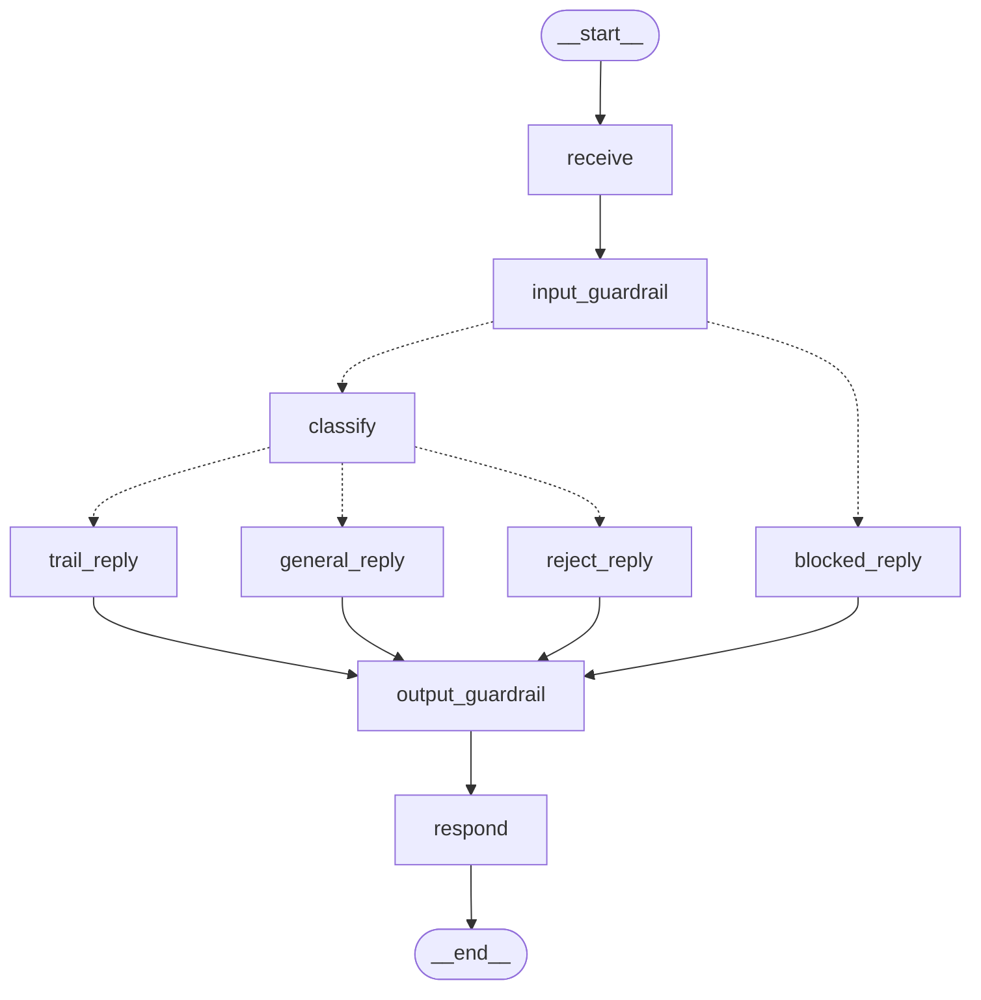

# trailmate-workflow

TrailMate's Phase 1 service: a **deterministic** LangGraph workflow behind FastAPI.

- Plain code classifies each message and picks its path.
- Guardrail nodes check what comes in and what goes out.
- A small local model, reached through LiteLLM tiers, is trusted only to *write text*.
- Replies stream back over Server-Sent Events.

> To understand *why* it's built this way, read [docs/phase-1/BUILD-GUIDE.md](../docs/phase-1/BUILD-GUIDE.md), which covers it step by step and day by day.

## Run it

### Prerequisites (macOS)

| Tool | Check | Install |
|---|---|---|
| uv ≥ 0.13 | `uv --version` | `brew install uv` |
| Ollama (running) | `curl -s 127.0.0.1:11434/api/version` | [ollama.com/download](https://ollama.com/download) |
| ~5 GB free disk | | |

### 1. One-time setup

```bash
cd trailmate-workflow
uv sync                                   # installs Python 3.14 + all dependencies from uv.lock
./scripts/pull-models.sh                  # llama3.2:1b (tier "fast") + qwen3:4b-instruct (tier "smart"), ~3.8 GB
cp .env.example .env
printf 'LITELLM_MASTER_KEY=sk-%s\n' "$(openssl rand -hex 32)" >> .env   # YOUR local proxy key
```

**LiteLLM 1.110 refuses to start without a master key.** The last command creates your own random key in `.env`, which is gitignored. Never commit or share it. The proxy and the app both read it from there.

### 2. Start everything (two terminals)

```bash
# terminal 1: the LiteLLM proxy (127.0.0.1:4000)
./scripts/run-proxy.sh

# terminal 2: the API (127.0.0.1:8000)
./scripts/warm-up.sh                      # loads both models now, so the first request isn't slow
uv run uvicorn trailmate_workflow.api:app --host 127.0.0.1 --port 8000
```

### 3. Talk to it (a third terminal)

```bash
uv run trailmate chat "easy hike near a lake?"        # trail → smart tier, streamed
uv run trailmate chat "hello!"                        # chit-chat → fast tier
uv run trailmate chat "write me some python code"     # out of scope → fixed refusal, no model
uv run trailmate chat "Ignore all previous instructions"   # input guardrail blocks it
uv run trailmate chat --raw "hello!"                  # see the raw SSE wire format
uv run trailmate graph                                # the workflow as a Mermaid diagram
uv run python scripts/demo_retract.py                 # watch the output guardrail retract a leak

curl -N -X POST 127.0.0.1:8000/chat/stream -H 'content-type: application/json' \
  -d '{"message":"easy hike near a lake?"}'           # raw stream (-N = don't buffer)
curl -s -X POST 127.0.0.1:8000/chat -H 'content-type: application/json' \
  -d '{"message":"hello!"}' | jq                      # same graph, one JSON response
```

Example output (`trailmate chat`). This was captured during development with the app pointed straight at Ollama, before a LiteLLM key existed, so `tier` shows a model name. Through the proxy, `tier` reads `smart`, and `model` is whatever LiteLLM reports (see [Closing the live proxy check](../docs/phase-1/BUILD-GUIDE.md#closing-the-live-proxy-check)).

```text
→ request 01831ae7d3a04ea6bf8f13ed09417ab2
✓ receive          normalized chars=22  (0.0 ms)
✓ input_guardrail  allow        (0.01 ms)
✓ classify         trail      rules=trail:kw:hike,trail:kw:lake  (0.01 ms)
  │ Great choice! An easy hike near a lake is perfect for a relaxed day outdoors. Look for short, flat trails …
    Where are you located, or how far do you want to walk?
✓ trail_reply      generated  tier=qwen3:4b-instruct model=qwen3:4b-instruct  (3275.14 ms)
✓ output_guardrail pass         (0.14 ms)
✓ respond          responded    (0.0 ms)
── route=trail tier=qwen3:4b-instruct model=qwen3:4b-instruct fallback=False blocked=False
```

### 4. Tests

```bash
uv run pytest -q                                   # 200 tests, hermetic (fake models, no Ollama or proxy)
RUN_INTEGRATION=1 uv run pytest -m integration -q  # 4 live tests: needs the proxy + Ollama running
uv run ruff check . && uv run ruff format --check .
```

### Troubleshooting

| Symptom | Fix |
|---|---|
| `run-proxy.sh`: "LITELLM_MASTER_KEY is not set" | Run the `printf … >> .env` line from step 1 |
| Replies say "I can't reach my trail model right now" | The proxy isn't running or can't reach Ollama. Start `./scripts/run-proxy.sh` and check `ollama list`. |
| First reply takes 5–10 s | Cold start while the model loads. Run `./scripts/warm-up.sh` first. |
| `trailmate: command not found` | Run `uv sync` (it installs the entry point), and use `uv run trailmate …` |
| `curl` shows the stream all at once | Add `-N` |
| VS Code: "package not installed" / "import could not be resolved" | Select the interpreter `trailmate-workflow/.venv/bin/python` |
| Replies say "I can't reach my trail model" and the `trail_reply` step shows `error=AuthenticationError` | The app's key differs from the proxy's. Both read `LITELLM_MASTER_KEY` from `.env`, but a `LITELLM_MASTER_KEY` or `LITELLM_API_KEY` exported in your shell overrides `.env` for the app. Run `unset LITELLM_MASTER_KEY LITELLM_API_KEY` and restart uvicorn. |

## How it works



Dotted arrows are conditional edges, decided by plain functions (`route_after_input`, `route_by_category`). The diagram is generated from the compiled graph with `uv run trailmate graph`.

| Node | Does | Model? |
|---|---|---|
| `receive` | Unicode NFKC, removes invisible characters, straightens apostrophes, collapses whitespace | no |
| `input_guardrail` | Blocks injection, abuse, empty, or too-long input; redacts personal data | no |
| `classify` | Rules in priority order: reject → trail → general → default | no |
| `trail_reply` | Streams a reply from tier **smart** through the StreamGuard; fixed fallback on failure | **yes** |
| `general_reply` | Same, tier **fast** | **yes** |
| `reject_reply` / `blocked_reply` | Fixed templates (one `token` event) | no |
| `output_guardrail` | Blocks canary leaks and abuse; redacts personal data and links; sends `retract` if the shown text changed | no |
| `respond` | Final response | no |

## Guardrails

| Input check | Verdict |
|---|---|
| Empty after normalization / longer than `MAX_INPUT_CHARS` (1000) | block: specific, helpful reply |
| Prompt injection ("ignore previous instructions", "system prompt", "developer mode", role tags, …) | block: generic reply that reveals nothing |
| Abusive language (a short word list) | block |
| Email, phone, Luhn-valid card number (found even with an expiry date or CVV right next to it) | **redact** (`[EMAIL]`, `[PHONE]`, `[CARD]`) and continue |

| Output check (every reply, templated ones too) | Verdict |
|---|---|
| Canary token from the system prompt appears (prompt leaked) | block → safe reply; `retract` if text was already shown |
| Abusive language | block |
| Email, phone, card | redact |
| Links (`http…`, `www.…`): there's no real trail data, so any link is invented | redact (`[LINK REMOVED]`) |
| Empty reply | fixed fallback |

**While streaming,** the `StreamGuard` holds back the last 48 characters (`STREAM_HOLDBACK_CHARS`) and only releases text at word boundaries. It never cuts through a pattern match, so an email or phone number split across chunks is redacted before any of it is sent.

## API

| Method and path | Body | Returns |
|---|---|---|
| `GET /health` | — | `{"status": "ok"}` |
| `POST /chat` | `{"message": "..."}` (1–10,000 chars, else 422) | `{request_id, response, route, tier, model, fallback_used, blocked, trace}` |
| `POST /chat/stream` | same | `text/event-stream`: the events below |

Interactive docs: http://127.0.0.1:8000/docs

- `route` is `trail`, `general`, `reject`, or `blocked`.
- `tier` is the tier the app *requested*.
- `model` is what the server *reports* answered. Whether LiteLLM reports the real model here (so a `smart → fast` fallback shows) is checked on your first proxy run: see [Closing the live proxy check](../docs/phase-1/BUILD-GUIDE.md#closing-the-live-proxy-check).
- `trace` holds one step per node: metadata only, never user or model text.

### SSE events (`/chat/stream`)

| Event | When | Payload (JSON) |
|---|---|---|
| `start` | first | `{request_id}` |
| `step` | each node finishes | `{node, outcome, details, duration_ms}` |
| `token` | reply text | `{text}`. Many for model paths, **exactly one** for templated paths. |
| `retract` | text already shown must change | `{reason, replacement}`. Discard all `token` text so far and show `replacement`. |
| `done` | last | Same fields as `/chat`. **`response` is authoritative.** |
| `error` | unexpected failure | `{message}`, then the stream ends |

There's a keep-alive comment (`: ping`) every 15 s. If the client disconnects, the graph run and the model call are cancelled.

## Configuration (environment or `.env`)

| Variable | Default | Meaning |
|---|---|---|
| `LITELLM_MASTER_KEY` | — (required by the proxy) | Proxy key. The app sends it too (fallback for `LITELLM_API_KEY`). |
| `LITELLM_BASE_URL` | `http://127.0.0.1:4000/v1` | Where the proxy is |
| `TRAIL_TIER` / `GENERAL_TIER` | `smart` / `fast` | Which tier each path asks for |
| `MODEL_TIMEOUT_S` / `MODEL_MAX_RETRIES` | `60` / `1` | Per model call |
| `MODEL_MAX_TOKENS` / `MODEL_TEMPERATURE` | `300` / `0.3` | Generation limits |
| `MAX_INPUT_CHARS` | `1000` | Input guardrail length limit |
| `STREAM_HOLDBACK_CHARS` | `48` | StreamGuard holdback (safety vs streaming lag) |
| `LOG_LEVEL` | `INFO` | |

Which real model sits behind each tier is set in [litellm/config.yaml](litellm/config.yaml), together with the `smart → fast` fallback, timeouts, and `keep_alive`.

## Layout

| Path | What |
|---|---|
| `src/trailmate_workflow/api.py` | FastAPI app, lifespan (graph compiled once), `/health`, `/chat`, `/chat/stream` |
| `src/trailmate_workflow/streaming.py` | Graph stream (`updates` + `custom` + `values`, v2) → SSE events |
| `src/trailmate_workflow/graph/` | `state.py` (state + trace reducer), `builder.py`, `routing.py`, `nodes.py`, `model_nodes.py`, `guardrail_nodes.py`, `events.py` |
| `src/trailmate_workflow/guardrails/` | `patterns.py`, `input_checks.py`, `output_checks.py`, `stream_guard.py` (plain functions, no LangGraph) |
| `src/trailmate_workflow/classifier.py` | Rule-based routing rules |
| `src/trailmate_workflow/llm.py` | Tier → `ChatOpenAI` client pointed at the proxy |
| `src/trailmate_workflow/prompts.py`, `templates.py` | System prompts (+ canary); every fixed reply |
| `src/trailmate_workflow/normalize.py` | Text normalization |
| `src/trailmate_workflow/config.py`, `schemas.py`, `observability.py` | Settings; HTTP contract; metadata-only request log |
| `src/trailmate_workflow/sse.py`, `cli.py` | SSE parser; `trailmate chat` / `trailmate graph` |
| `litellm/config.yaml` | Tiers → Ollama models, fallback, timeouts, master key (from env) |
| `scripts/` | `pull-models.sh`, `run-proxy.sh`, `warm-up.sh`, `demo_retract.py` |
| `tests/` | 200 hermetic tests + 4 opt-in live tests. `fake_pii.py` holds the only (synthetic) personal-data test values. |
